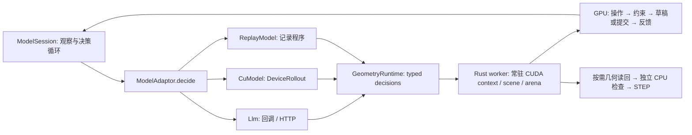

# 持久 GPU 建模会话

本版实现 `ModelSession → ModelAdaptor → GeometryRuntime` 的反馈闭环。模型决定构造、探索、分支和修复；harness 只检查已声明的协议、资源和几何约束。模型切换保留同一个 CUDA context、场景、目标、对象及草稿。

架构入口为 [review](SELF_IMPROVEMENT_REVIEW_V2.md)。本文件的驻留 GPU 后端是四片 bicubic hood，192 个控制坐标、6 个兼容形变自由度；134 项能力库尚未全部接入此会话执行器。它是架构 MVP，不是 CATIA 对等的通用造型系统。

本文件描述 `cuda-hood-v1` 后端。另已新增 [工程支持与文档后端](ENGINEERING_SUPPORT.md)，通过同一 ModelSession/ModelAdaptor 调用类型化工具程序，支持自由创建更高次曲面、Class-A 诊断、设计意图和受预算控制的拓扑操作；其 GPU 驻留和事务模式分别说明。

新 [resident-engineering-v2](RESIDENT_SURFACES.md) 将 NURBS 求值/细化和多片曲面优化保存在持久 GPU 服务中，使用同一模型工具决策协议；当前 CuModel 的已训练能力仍限于本文件的 hood 路径。

## 运行

使用项目既有 Rust/CUDA、Python NumPy/SciPy/OCP 环境。`run.ps1` 初始化本机 MSVC/CUDA 路径。仓库已有模型文件 `output/diagnostics/model/probe_policy.f64`；需要重训时运行 `./run.ps1 train-proposals`，明确使用 CPU Candle 训练。

```powershell
.\run.ps1 session --require-goal
.\run.ps1 test-session
.\run.ps1 test
.\run.ps1 lint
python -m unittest discover -s scripts -p test_model_adaptor.py -v

# 同一执行器上的纯 GPU 模型路径，可换目标
.\run.ps1 session --model cuda --target 3 -2 1 2 -1 3 --require-goal

# 核对上述已保存产物，并生成带 SHA-256 清单的源代码/结果包
python scripts/session_delivery.py --package
```

默认 demo 使用记录的两个程序制造并修复草稿，再切换 `CuModel`。记录程序是 `ReplayModel`，并非真实 LLM 推理。它验证：非法草稿提交失败后保留；从 committed 状态分支；模型根据反馈修复；允许合法上坡；拒绝过期 revision；切换后 16 次 GPU 推理没有中间主机决策读回；分支互不影响；最终 STEP 可重读。

产物默认保存在 `output/sessions/<model>/`，显式 `--out` 可覆盖。重复运行会更新该目录中的证据。

| 文件 | 用途 |
|---|---|
| `session_hood.step` | 4 面、0 实体的曲面 STEP；无 SolidWorks 原生导入验收声明 |
| `validation.json` | 事务、模型推理、目标和独立 CAD 校验结果及源文件摘要 |
| `scene.json` / `template.bin` | 用户契约、基准几何、物理坐标映射和模型权重快照 |
| `model-events.json` | 每次模型决策、错误、反馈、模型切换及调用计数 |
| `ipc-events.json` / `worker-report.json` | IPC 字节、CUDA 上传/读回、动作预算、内存请求及耗时 |
| `worker-source.cu` / `worker.ptx` | 实际执行的 CUDA 源码与 PTX |
| `worker-stderr.log` | 启动与执行诊断；不记录模型认证 token |

## 责任与传输路径



- **Python 控制层**管理模型状态、供应商传输、语义决策和日志。`decide(observation)` 是当前共同接口；旧 `propose(context, requests)` 仅为诊断兼容接口。
- **Rust worker**拥有一个 CUDA context、stream、模板和有界对象 arena。它先检查帧、版本、句柄和预算，再执行 CUDA。没有为同一角色重复定义第二个 Rust 模型接口。
- **Host program**一次提交最多 64 个动作；默认在拒绝时 yield，让模型读取反馈后决定修复。`on_error: continue` 是模型可选策略。
- **DeviceRollout**绑定明确的模型 ID 和权重摘要。最多 64 步推理、提案和更新在一个设备执行内完成，只返回最后的摘要与轨迹。本版 CuModel 只学习 `ADD_PROBES` 的六个参数，未学习原语选择。
- **CPU CAD**在显式交付阶段下载控制点，独立检查原始几何语义，构建和重读 STEP。设备端推理不意味着 STEP 导出也在 GPU 上完成。

统一的是建模意图、对象引用与反馈。LLM 无需压缩为小模型的 12 维输入；当前小模型可选择的能力也不限制 LLM 使用更丰富的事务操作。GPU 内层无中间读回与外部 LLM 每轮需要反馈的成本分别计量。

## 对象、事务与约束

对象句柄为 `(session_id, slot, generation, revision)`。generation 防止删除后槽位重用的旧句柄误写；revision 在草稿开始、草稿编辑、放弃和提交时更新。跨会话、过期句柄、过期 revision 均拒绝。模型可 `fork/select/drop/inspect`，分支复制 committed 几何，不复制父对象的未完成草稿。目标跟随分支且保持不可变。

| 操作 | 参数与行为 |
|---|---|
| `ADD_PROBES` | 6 个探针增量，mm；通过兼容映射 W 修改活动几何 |
| `SET_PROBES` | 6 个相对基准的绝对探针位移，mm |
| `RAW_CONTROL_DELTA` | `index=48*patch+12*u+3*v+xyz`；`values[0]` 为坐标增量，mm |
| `BLEND_REFERENCE` | `values[0]∈[0,1]`；通过 W 降低探针位移；不自动修复 raw 草稿的约束残差 |
| `BEGIN / COMMIT / ABORT` | 创建私有草稿 / 检查后提交 / 放弃草稿 |
| `MEASURE / STOP` | 返回摘要 / 结束模型执行；STOP 遇到开放草稿会拒绝 |

活动几何是打开的草稿，否则是 committed。没有 BEGIN 时每次几何动作独立提交；多动作程序不会隐式变成原子事务。需要事务时由模型明确使用 BEGIN/COMMIT。

有限值与绝对坐标 ≤1e6 mm 在每次几何操作检查。固定 XY、固定外边界、兼容等参数 C2 接缝及镜像对称在提交时按 1e-7 容差检查；开放草稿可暂时违反这些几何条件。失败 COMMIT 保留草稿。非草稿的非法改动保持原 committed 几何。仿射 W 是声明的参数化映射，不是代替模型搜索的隐藏优化器。

质量分数为六个探针目标误差平方和，仅作为反馈。合法上坡允许提交；没有自动恢复最佳状态。旧诊断接口的 `RESTORE_BEST` 没有进入新会话协议。

最终目标采用 `max_probe_error_mm`。调用方通过 `--goal-tolerance-mm` 设置容差；`--require-goal` 把它声明为交付要求，否则只报告是否达成。模型无法覆盖目标、容差和资源；已声明的强制目标不能由导出参数降级。STOP、动作是否被接纳、几何有效、目标达成和交付有效分别记录。

动作预算由全部分支共享，范围 1–4096；每程序/rollout 为 1–64。提交时预留整个程序的动作数，包括拒绝和提前 yield 后的未执行槽位，防止靠拆分/失败绕过预算。计量另报实际执行动作数。对象容量 1–64；每 worker 最多 1024 个后端请求，模型决策上限由调用方设置为 1–256。删除对象不会退还动作预算。

## 接入 LLM

`Llm(provider)` 接收 `provider(observation_dict) -> decision_dict | JSON string`。观察包含不可变契约副本、基准几何、当前 committed/draft 探针、目标、约束反馈、对象目录、剩余预算、操作参数说明和决策响应示例。模型可先请求完整当前或草稿控制点，然后再决定。

HTTP bridge 是本项目的供应商无关 JSON 契约，需要服务端将观察交给实际模型并返回结构化决策；不是任意供应商现有 API 的直接兼容声明。

```json
{
  "schema": "cad-model-request-v1",
  "model": "your-configured-model",
  "observation": {"schema": "cad-observation-v1", "...": "完整观察"}
}
```

响应示例，ID 和 revision 必须使用收到的观察值：

```json
{
  "decision": {
    "schema": "cad-decision-v1",
    "kind": "program",
    "object_id": "从 observation.object.id 复制",
    "scene_revision": 0,
    "actions": [
      {"op": "BEGIN"},
      {"op": "ADD_PROBES", "values": [1, 0, 0, 0, 0, 0]},
      {"op": "COMMIT"}
    ],
    "on_error": "yield"
  },
  "usage": {"provider_defined": true}
}
```

```powershell
# 配置自己的模型服务；认证可通过 CAD_MODEL_TOKEN 环境变量提供
.\run.ps1 session --model llm --provider-url http://127.0.0.1:9000/decide --provider-model your-model --require-goal
```

其他 decision kind：`inspect` 带 `geometry/draft`；`fork` 带 `select`；`select` 带 `selected_object_id`；`drop` 带 `drop_object_id`；`device_rollout` 带 `steps/model_id/weights_sha256`。均使用同一 envelope。为删除当前焦点对象，先选择另一个对象。

本机 HTTP fixture 已验证传输、当前反馈、结构化执行及 token 不进入观察/事件。尚未配置和调用真实外部 LLM，默认 demo 不作该声明。

## 验证边界

当前验收覆盖真实 CUDA 草稿修复、分支与 ABA、过期 revision、共享预算、模型响应不可覆盖契约、合法上坡、STOP 未达标、HTTP fixture、强制目标和进程启动失败清理。Rust 帧检查、Clippy 和旧适配器测试也已通过。

默认集成报告保存在 [validation.json](output/sessions/demo/validation.json)，曲面为 [session_hood.step](output/sessions/demo/session_hood.step)。报告包含逐步 CPU/GPU 提案一致性，以及重读 STEP 的 324 个 off-grid 点。STEP 检查证明本次文件与源曲面吻合；不构成任意曲面的完备验证或 SolidWorks 导入实测。

纯 CuModel 换目标运行也已通过：目标 `[3,-2,1,2,-1,3]` 下，16 次设备推理达到约 0.04401 mm 最大误差。源代码与两组结果交付包为 `output/delivery/rust-cuda-modeling-sessions-v1.zip`；包不包含 CUDA/MSVC、Python 依赖或编译缓存，需按项目环境重新构建。产物核对脚本只核对保存的证据，不代表重新运行了全部测试。

后续扩展沿同一接口增加类型化曲线/曲面/网格/实体句柄、区域选择、依赖图与批执行后端。当前一次请求只处理一个对象，没有通用并行 DAG 调度、拓扑事务、任意 nonlinear G2 检查或自动递归晋级。没有宣称相对解析设置/CPU 的速度或建模质量优势。
