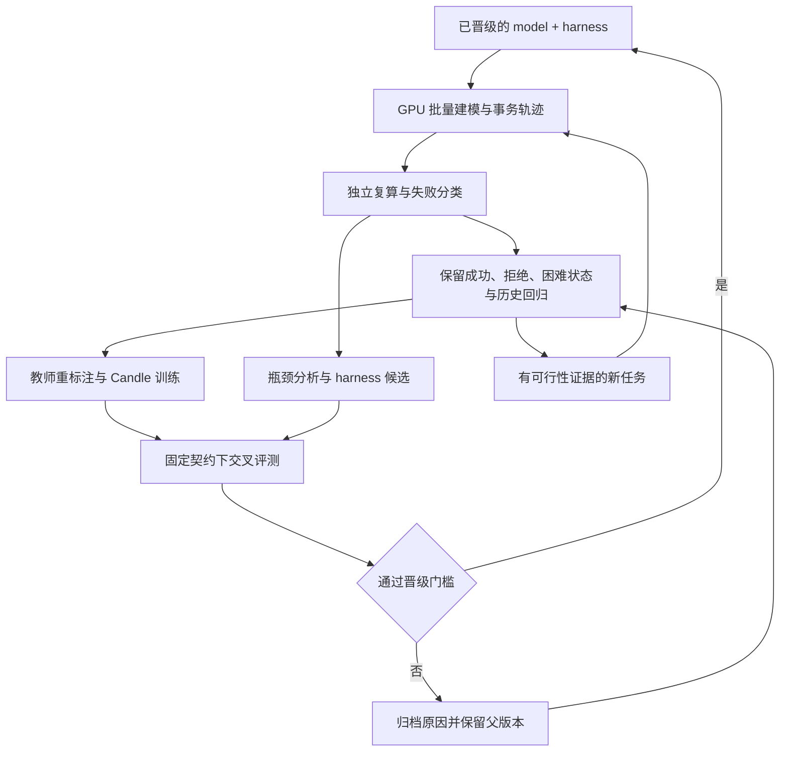

# GPU CAD harness 与模型的递归改进计划

本计划已由 [ModelAdaptor 架构 review，revision 3](SELF_IMPROVEMENT_REVIEW_V2.md) 修订：
`Llm` 与 `CuModel` 承担同一个模型角色，harness 负责约束，允许模型自主选择建模与探索策略。
以下内容及 `configs/improvement-plan.v2.json` 保留为历史提案；固定观察维度、强制单调改进等不再作为默认架构要求。

日期：2026-11-20。状态：设计提案；配套 `configs/improvement-plan.v1.json` 是计划参数，当前没有执行器。
本次只建立计划，不启动训练、代码进化、后台循环或版本切换。数值预算和晋级阈值均为首轮建议，不是已经取得的结果。

目标是让有效建模轨迹改进策略，让策略暴露的新问题改进 harness，再用改进后的 harness 收集下一代数据。
每代同时记录几何质量、正确性、覆盖范围和计算成本；允许一代没有候选晋级。

## 1. 从现有实现出发

| 已有组件 | 当前能力与证据 | 本计划的作用 |
|---|---|---|
| v6 harness | 32 候选 × 8 轮；共享模板；GPU 事务/检查/回退；同次运行逐位重放；一次最终读回 | 回归锚点和事务基础 |
| 四曲面约束 | 192 坐标、400 硬行、秩 186、6 剩余自由度；冠高目标可用精确仿射映射直接求解 | 保留精确求解器，作为校准和 warm start |
| 小模型 | Candle 5→24→25，769 参数；只产生原有四槽建模指令，尚无反馈输入 | 训练/权重导出经验可复用；现有权重不能直接充当新反馈策略 |
| 原语库 | 134 项有范围限制的能力，部分为 CPU CAD/网格后端 | 后续逐个接入，不能把库计数当作 GPU 动作数 |
| 独立验收 | 全坐标 KKT、故障注入、STEP 重读、196 距离探针 | 构建独立验收层 |

当前证据见 `output/harness/validation.json`、`HARNESS.md` 和 `GPU_POLICY_MVP.md`。
v6 的 2.323232 ms 是当次主图时间，不是训练/导出端到端基准，也不是递归改进效果。

先建立含非线性目标的 v7 bootstrap，固定反馈 ABI，随后开始递归迭代。
v6 与新策略的输入/动作不同，因此不能直接把 v6 当作新模型 2×2 消融实验的兼容父版本。

## 2. 两个时间尺度、三条改进路径



**GPU 内层**：特征提取 → 策略推理 → 原语/求解操作 → 独立检查 → 提交或回退 → 轨迹。
初版每个 episode 最多 32 轮；中间不做主机决策或读回。权重、模板、状态和有界试验分支常驻显存。

**实验外层**：一个批次结束后读取轨迹、独立复算、重标注、训练、编译候选、重新建立图和评测。
这些 CPU/磁盘操作发生在批次或代之间，不要求整个训练过程零 host 交互。单张 8 GB GPU 上训练和 rollout 分时运行。

| 路径 | 可以提出的变化 | 选择依据 |
|---|---|---|
| 模型 M | 策略/价值头权重、训练采样、损失权重；首轮架构固定 | 未见任务的完成率、误差和实际操作成本 |
| Harness H | 步长搜索、缓存、批处理/融合、布局、活跃候选调度、校验实现优化 | 相同契约下的正确性、质量、延迟和显存 |
| 任务生成 G | 初始形状、目标截面、曲率范围、尺度和失败边界的组合 | 可行性证据、难度及覆盖度 |

后续可学习“下一笔实验预算投给训练、补数据还是改 kernel”，使实验调度本身也得到改进。
其收益仍由外部固定验收计算；首轮用确定性预算分配，不同时引入学习调度器。

## 3. 独立验收契约

每个实验包固定 `goal_contract_id`、`oracle_id`、容差、几何有效性定义、资源预算和成功条件。
模型生成动作；harness 执行动作；独立评估器重算结果。模型自己的价值、置信度和预测成功均不充当验收结论。

可以优化 GPU 校验器实现。新实现需要通过旧实现、独立 CPU 数值计算、OCCT 和变形测试的交叉验收，
尤其检查临界合法样本的误拒绝与非法样本的误接受。修改测试答案、放宽容差、删除困难用例或修改评分器不属于同一契约下的改进。
能力或契约扩展要新建版本，继续单列旧契约回归结果。

检查分层：

1. **设备检查**：ABI、有限性、预算/修订、原始硬约束、动作边界、约定采样位置的几何与曲率、固定用户目标。
2. **批后独立复算**：用不同实现核对已提交状态；增加更密和偏移采样，保留检查器不一致的最小反例。
3. **交付检查**：晋级评测至少选 64 个分层 STEP 案例；每个实际交付模型都做原生 NURBS/STEP 重读和距离检查。

首版曲率限制明确为采样约束，更密采样也不能证明整个连续曲面没有自交或超限。
需要连续域保证时，单独加入 Bernstein/区间界等证书；无法判定的结果标为 UNKNOWN，不自动算成功。
CPU 求解器没有找到解也不等于数学上不可行；只有构造证明或经过确认的冲突证据才标记 INFEASIBLE。

保留 v6 的全部拒绝/回退与重放测试，加入目标评分不可改写、假 STOP、错误缓存、轨迹伪造、近容差合法/非法、
NaN/Inf、预算透支、过期权重/模板、单位变换等案例。变形测试同步变换容差和曲率单位；
XY 投影检查只对其适用坐标变换作等价性断言，不能假设任意三维旋转均适用。

“封存审计集”首先是流程隔离。若代码提案器可以读取整个工作区，不能宣称数据真正隐藏。
完整自动化时，评估器与封存数据放在单独受限进程/目录，候选只接收允许的评测输出。

## 4. 首个有用任务：非线性四曲面造型

继续用 `x=x0+Zy` 表示可行控制网，初版保持 6 DOF，固定外边界和兼容 C2 接缝。
任务包含多个截面目标、平顺目标、主曲率软目标及采样曲率硬上限，不再只有一个冠高标量。

建议评分形式：

```text
J(x) = 截面位置的归一化平方误差
     + lambda_fair * 归一化弯曲能量
     + lambda_curvature * 采样曲率的软超限惩罚

PASS = 输入合法 && 所有硬检查通过 && 用户的目标误差/曲率标准达到
```

权重和归一化尺度由任务契约给定。STOP、预算耗尽、局部最优和“尚有有效曲面可保留”各有单独状态，不等价于 PASS。
已知仿射解继续作为基线或 warm start；非线性参考采用投影梯度/信赖域及多初值求解，不能声称得到全局最优。

数据生成先从已检查的 `y_witness` 构造可行曲面，再生成其可达范围内的目标/上限。
见证用于独立生成校验，不作为策略输入。没有见证、证明或成功参考的任务放入 UNSOLVED 档案，不直接充当有解训练题。
首轮固定拓扑；增加 patch 数、任意 G1/G2、裁剪/布尔等另立能力阶段。

初版动作：

| 动作 | 实现约束 |
|---|---|
| DELTA_NULLSPACE | 给 6 个自由度增量；投影后限制物理位移和步长，保留硬等式 |
| PROJECTED_SMOOTH | 执行归一化平顺方向并投影回可行子空间；每个试验仍检查固定目标 |
| STOP | 终止当前候选；独立成功条件仍需满足 |

每轮最多 4 个试验分支；初始状态评估 1 次，之后最多 128 次状态几何评估，总计最多 129 次。
有限差分等额外状态查询同样消耗这 128 次预算，因此会减少剩余试验机会；解析梯度/JVP 等派生计算另列次数与实际耗时。
特征提取复用已经得到的状态求值，不能把隐含重采样或教师查询藏在一次“动作”中。
分支缓冲区属于新的 v7 ABI，不能直接越过 v6 的候选/布局上限。
先保持当前 best 的单调提交。后续若要跨越局部障碍，可在独立分支保留暂时较差但可行的搜索状态；
交付 best、分支预算和最终验收保持独立，所有额外评估计费。

## 5. 模型如何逐代学习

建议初始反馈网络：**72→64→64→12，tanh 隐层，共 9,612 个含偏置参数**。
这是新模型，不覆盖已有 769 参数四槽模型。初版按候选批量推理，不沿用旧的单线程四槽内核。
策略可用 f32，几何与敏感验收继续 f64；跨实现数值对照通过后才启用混合精度优化。

| 观察组 | 维度 |
|---|---:|
| 当前归一化 y | 6 |
| 目标形状/尺度描述 | 8 |
| 固定采样位置的目标残差 | 24 |
| 曲率与超限统计 | 8 |
| 上次结果码 one-hot | 16 |
| 预算和剩余轮次比例 | 2 |
| 上次步长、上次改善、当前分数、停滞计数 | 4 |
| 硬约束/局部几何等有效性指标 | 4 |

输出为 3 个动作 logits、6 个 DOF 增量、1 个平顺步长、1 个预期回报和 1 个失败概率。
精确字段顺序、单位、裁剪及缺失值规则由版本化 observation/action schema 固定；训练和 CUDA 解释必须逐槽对照。
预期回报和失败概率只用于选择试验和诊断，不能跳过验收。

学习顺序：

1. **教师初始化**：投影优化器和有界短视搜索产生动作，独立检查后做行为克隆。
2. **策略访问状态重标注**：让当前模型 rollout，在它实际到达的状态上重新查询教师，聚合到数据集。
   采用 DAgger 的数据聚合思路，处理动作改变后续观察分布的问题；它不保证本 CAD 任务必然改善。[DAgger 原文](https://proceedings.mlr.press/v15/ross11a.html)
3. **反事实分支**：在相同状态/目标上试若干步长或动作，保存真实分数差、失败原因和后续有限步回报。
   教师失败时保留 UNKNOWN；不把模型自评转换成正确标签。
4. **联合损失**：动作分类 + 有效动作的连续参数损失 + 真实回报回归 + 失败原因/概率辅助项。
   无效动作作为负例和诊断，不作为正向参数模仿标签。尚未达标且教师暂时无解的状态不直接标成成功 STOP。
5. **再考虑策略优化**：仅在克隆/重标注基线稳定且验证器足够可靠后，尝试有界策略梯度或搜索蒸馏；仍用外部验收晋级。

训练反馈可取固定目标的真实改善，减去实际评估次数及非法尝试代价。
训练奖励系数版本化；是否晋级始终使用用户任务指标和资源成本，不比较训练 loss 大小。
Replay 建议配比：40% 历史已验证数据、30% 当前模型困难状态、20% 多样性采样、10% 拒绝/边界案例。
保留失败轨迹，防止只训练自己已经会做的形状；数据按模板祖先与任务族切分，不能仅打乱相近样本。

## 6. Harness 如何逐代改进

首轮每代最多 4 个 harness 候选，单个候选只改一个主要因素，保留父版本。

| 优先级 | 候选变化 | 验证重点 |
|---|---|---|
| H1 | 合并特征/残差计算，减少重复读取；缓存确定不变的量 | 原始契约下分数、特征、检查结果一致；缓存键完备 |
| H2 | 步长回退、信赖域和试验分支调度 | 相同评估预算的任务改善；不能把新增搜索成本藏起来 |
| H3 | 批量策略推理、活跃候选打包、按拓扑/尺寸分桶 | 小批与大批的延迟/吞吐，ID/修订/轨迹不串用 |
| H4 | 检查器精度与采样分配优化 | 不新增误接受，不扩大误拒绝；与独立高密参考对照 |
| H5 | 更强求解器/新原语/新拓扑 | 新能力版本、独立 CAD 参考与旧任务回归；不纳入首轮同 ABI 优化 |

先用有界参数/实现变体搜索，再引入离线 Rust/CUDA 代码补丁提案。
代码可由开发代理或以后配置的 LLM 生成；小型建模策略只负责动作，不承担编译器或代码生成器角色。
默认不依赖外部模型 API。补丁在独立候选目录编译，超时/崩溃/错误即拒绝，不在活动 episode 中自改内核。
评估反馈驱动程序候选迭代的思路可参考 [AlphaEvolve 原始论文](https://arxiv.org/abs/2506.13131)；本项目是否有效需要本地实验。

当前固定图与设备掩码先保留。CUDA 12.6 文档描述了 IF/WHILE conditional nodes；是否用于本机
需先验证实际驱动、cudarc/FFI 接口和图限制，不把它作为首轮前提。[CUDA 12.6 图文档](https://docs.nvidia.com/cuda/archive/12.6.3/cuda-c-programming-guide/index.html#conditional-graph-nodes)
图结构变化、网络结构变化和 ABI 变化在外层重新编译/建图；同一个正在执行的图保持参数与分配生命周期稳定。

## 7. 课程与多样性

按尺度/长宽比、目标曲率、初始误差、接缝结构和拒绝原因分格，保留每格的好轨迹与困难反例。
目标是扩大有效能力覆盖范围，防止只保存单一容易造型。分格档案借鉴 [MAP-Elites](https://arxiv.org/abs/1504.04909) 的多样性思路；
首版使用简单确定性分桶，不要求完整实现该算法。

新任务优先选择“有可行性证据，但当前模型成功率约 20%–80%”的训练桶；
同时保留容易任务及边界拒绝测试。难度阈值是课程启发式，不能据此删除晋级评测中的难题。
生成器只能读训练/开发数据。每代收集的失败可以进入下代训练；已消费的资格评测集随之退休，新的资格集使用独立种子。

首轮任务数量建议：

| 集合 | 模板 × 每模板任务 | 使用方式 |
|---|---:|---|
| 初始训练 | 128 × 32 = 4096 | 见证、教师轨迹和策略访问状态 |
| 开发集 | 16 × 32 = 512 | 调参和每代候选提名 |
| 每代资格集 | 32 × 32 = 1024 | 每代只评一次提名组合；3 代各用独立集 |
| 最终封存审计 | 32 × 32 = 1024 | 最终提名版本单次使用；失败后该集退休 |

模板先编译并分组共享，不对每一步重新 SVD。任务生成祖先、模板族和变换后的近重复均参与去重/切分。
晋级按模板族聚类统计，避免把同模板的 32 个相近目标当成完全独立样本。

## 8. 晋级、归因与停止规则

建立非线性兼容基线后，每代采用相同任务/随机种子做交叉实验：

| 组合 | 用途 |
|---|---|
| Hn + Mn | 父版本 |
| Hn + Mnew | 测模型贡献 |
| Hnew + Mn | 测 harness 贡献 |
| Hnew + Mnew | 测组合及交互效应 |

另外保留确定性投影优化器基线，匹配实际几何评估次数和 GPU 时间上限。
新模型或 harness 可以单独晋级；只有组合改善时也可以作为耦合版本晋级，但必须披露单独替换未带来收益。
首轮锁定观察/动作 ABI；后续不兼容扩展按新能力版本评测，不伪造不存在的交叉组合。

所有候选先满足共同门槛：

- 保留的硬约束、错误拒绝、预算、目标不可变、回退、内存边界及同二进制重放测试全部通过。
- 独立审计中观测到的非法提交/错误成功标记为 0；64 个分层 STEP 案例及实际交付案例全部通过。
  这是有限测试证据，不是任意输入的完整正确性证明。
- 任务成功率相对父版本的置信下界不低于 -1 个百分点；任何预登记关键任务族的点估计下降不超过 2 个百分点。
- 没有中间 host 决策读回；每个 episode 批次保持一次最终打包读回。训练/教师/资格评测的读回单列。
- 资源、查询数和训练成本完整记账；没有因为减少有效工作或修改任务定义而获得表面加速。

候选在开发阶段预先选择一个晋级主指标，再用本代资格集确认，满足下列其一：

| 路线 | 首轮建议的最低收益 |
|---|---|
| 完成率 | 提升至少 3 个百分点，配对改善的置信下界 >0 |
| 质量 | 预登记归一化几何误差降低至少 5%，配对收益的置信下界 >0 |
| 性能 | p50 GPU 建模时间降低至少 10%，延迟比置信上界 <1，p95 不增加超过 5% |

质量同时报告全体任务与共同成功子集，失败任务使用预登记处理规则；不能只挑双方成功的容易题。
首版建议采用模板族聚类的配对 bootstrap，置信水平 99%，bootstrap 10,000 次，三次提名的检验规则预先固定。
性能测量建议 5 次预热、30 次配对随机顺序重复；报告 p50/p95、吞吐、显存、实际评估数及含编译/STEP 的端到端成本。
最终 audit 只用于最后提名确认，不用于在多个候选中反复选择。样本不足或置信区间过宽时保留父版本。

首轮最多 3 代、总墙钟预算 2 小时；连续 2 代无晋级、契约/检查器不一致、预算用尽均停止本轮并写出原因。
OOM 先将批次减半，最低 8；仍无法运行则归档失败。候选失败不覆盖父版本。
完成三代实验与取得改进分别记录；只有受控实验支持模型和 harness 各有收益时，才报告“双向改进已验证”。

## 9. 版本、数据与可复现性

每个 run 固定以下标识：

```text
run_id, parent_bundle_id
model_hash, harness_source_hash, ptx_hash, abi_id
goal_contract_id, oracle_id, taskgen_hash
dataset_manifest_hash, split_id, seeds, training_config_hash
toolchain, device, driver, timings, measured_costs
```

每步保存状态 ID、模板/目标版本、观察、提议动作、实际动作、试验/提交分数、检查指标、拒绝原因、
累计预算及后继 ID。涉及多个分支时保存每个分支成本与选择原因。
为了训练和独立复算，v7 增加有界观察/动作轨迹和控制网/DOF 检查点；不能假设现有 v6 的 24 槽轨迹已足够训练反馈模型。
原始失败、教师修正和正向模仿标签分开存储；模型训练从清单指定快照读取，禁止同一代训练时悄悄改数据。

当前工作区不依赖 Git 才能复现：建议不可变 `experiments/<run_id>/` 和内容寻址 `versions/<bundle_hash>/`。
晋级写入带父标识和完整证据的记录，校验后原子更新 `registry/champion.json`；保留旧包和一条命令的恢复路径。
原子文件切换及 hash 不能代替访问隔离，保护性评估仍由独立评估进程执行。

默认显存上限 6 GiB、热轨迹缓冲 512 MiB、首轮磁盘增量 2 GiB；预分配并测量实际占用。
每代最多 2 个模型候选、4 个 harness 候选；权重更换与 NVRTC 均在批次之间完成。
外部 LLM/API 调用预算默认 0；以后使用代码提案服务时单独配置提供者、数据范围及调用预算。

## 10. 实现里程碑与文件落点

| 阶段 | 计划工作 | 验收与交付 |
|---|---|---|
| S0 固定实验底座 | 版本清单、任务/契约 schema、确定性数据切分、v6 回归及计费 | 同 bundle 可重放；篡改目标/标签/版本的测试被拒绝；基准可重复 |
| S1 非线性任务 | 四片曲率与多截面任务、可行见证、DOF 动作、确定性投影教师、CPU 独立参考 | 首批 128 题和梯度/曲率对照；32 轮 GPU 闭环；PASS/UNSOLVED/INVALID 分开 |
| S2 反馈模型 | Candle 新 trainer、72 维观察、12 维输出、批量 CUDA 推理、完整轨迹 | Rust/训练/CUDA 三方逐槽一致；能根据拒绝反馈改变后续动作；STEP 交付通过 |
| S3 模型递归 | 教师重标注、反事实动作、Replay、课程档案 | 一代自动收集→重标注→训练→资格评测→保留/晋级，失败也有完整收据 |
| S4 Harness 递归 | 一次一个因素的候选变体、独立编译、交叉评测、父版本恢复 | 至少一组真实 harness 提案走完通过或拒绝路径；无虚构性能收益 |
| S5 三代试点 | 联合外层执行器、预算/停止、最终 audit、版本包 | 最多三代的 lineage、消融、指标/成本、失败原因、恢复演示和最终 STEP |
| S6 扩展 | 新任务族/原语、更多 patch、非线性 G1/G2、拓扑事务及学习实验调度 | 各自新增契约与独立几何基准；保留之前能力与费用曲线 |

建议新增文件，均尚未实现：

```text
src/bin/evolve.rs                   # 有界外层：collect/label/train/qualify/promote
src/improvement/registry.rs         # 不可变版本、lineage、恢复
cuda/feedback_policy.cuh            # 批量反馈网络
cuda/harness_nonlinear.cu           # 曲率、DOF 事务、观察、试验分支与轨迹
trainer/src/bin/feedback.rs         # Candle BC/重标注训练
scripts/nonlinear_tasks.py          # 见证、任务族与切分
scripts/independent_oracle.py       # 独立几何/曲率/STEP 复算
scripts/qualify_generation.py       # 交叉评测、统计与成本
contracts/feedback-v1.json          # 固定字段、单位、语义和容差
experiments/<run_id>/               # 输入、代码、权重、轨迹、评测及收据
registry/champion.json              # 经验证的活动版本指针
```

**第一批实现限定 S0 + S1**：先交付 128 个有证据的非线性任务、确定性 GPU 基线和独立 oracle，
再开始训练新策略。这样后面的每轮训练和 harness 提案都有明确、固定且可复核的改进目标。

研究来源用于说明设计依据，不表示已经复现论文系统或获得其性能/收敛保证：
[DAgger](https://proceedings.mlr.press/v15/ross11a.html)、[AlphaEvolve](https://arxiv.org/abs/2506.13131)、
[MAP-Elites](https://arxiv.org/abs/1504.04909)、[CUDA 12.6 图](https://docs.nvidia.com/cuda/archive/12.6.3/cuda-c-programming-guide/index.html#cuda-graphs)。
