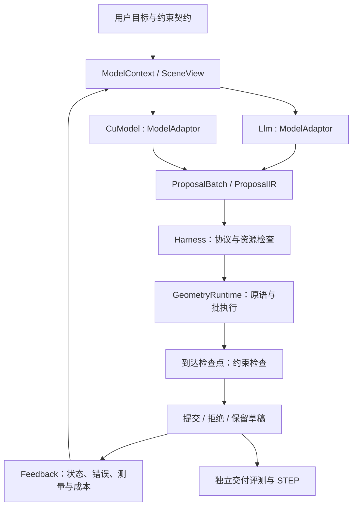

# GPU CAD Review：ModelAdaptor 与约束执行架构

修订：2026-11-20，revision 6。增加 GPU 常驻 NURBS、多片联合优化与工具后端；保留原诊断证据。

本文是当前架构设计入口。先前 v2 分析保存在 [历史 review](SELF_IMPROVEMENT_REVIEW_V2_PRE_ADAPTOR.md)。
[最初递归计划](SELF_IMPROVEMENT_PLAN.md) 与 `configs/improvement-plan.v2.json` 保留为历史提案；其中固定反馈维度、强制单调改进、教师主导和先冻结网络的建议，不再作为本架构的默认要求。

**目标：最大化 LLM 或本地模型的建模能力；harness 负责执行约定与约束。两类模型承担同一个角色，通过 ModelAdaptor 替换。**

本文区分目标设计、当前实现和已有验证。持久 Rust/CUDA worker、反馈驱动的 ModelSession、私有草稿、分支和模型切换已经实现。实际运行范围仍为固定四曲面 hood；通用 CAD 图、真实外部 LLM 推理和递归提升尚未完成。[运行与协议说明](MODEL_SESSIONS.md) 记录当前可用接口。

新增 [工程支持](ENGINEERING_SUPPORT.md) 扩大可运行范围：模型可通过 `ToolProgram` 在工程文档中创建三至七次曲面、匹配/诊断/平顺、求解设计意图及调用受容差预算控制的拓扑服务。它与旧 hood 后端共用模型决策接口，尚未形成全部原语的自动依赖图或通用常驻 GPU CAD 内核。

后续 [常驻曲面后端](RESIDENT_SURFACES.md) 已提供显存曲面句柄、缓存基函数/PTX/CUDA Graph、NURBS jets/保形细化和多片 Bézier 的 G1/G2/G3 约束优化。CPU 编译基函数/约束结构、GPU 重复求值与搜索、CPU 稳健拓扑交付的边界明确；仍无完整特征依赖图和新增工具的 CuModel 训练。

## 1. 四个责任边界

| 层 | 负责 | 决策归属 |
|---|---|---|
| Model | 理解目标、提出构造方案、选择原语、分支搜索、探索、修复、压缩技能 | `Llm` 或 `CuModel` |
| ModelAdaptor | 将模型的输入输出适配为共同的上下文、提案和反馈语义；管理模型侧状态 | 适配机制；不偷偷替模型选择更优几何 |
| GeometryRuntime | 曲线/曲面/网格/实体原语、测量、求解、对象存储与依赖、GPU 批执行、CPU CAD 后端 | 执行提案中请求的操作 |
| Harness | 固定用户契约、检查提案与事务、资源计量、约束判断、提交/拒绝及反馈记录 | 是否满足已声明的执行约定 |

质量求值是反馈服务；独立评测是外层验收机制。二者都不自动获得模型的规划权。
确定性优化器是可供模型调用的工具或对照策略；不把它藏进 harness 后声称模型完成了规划。



`Llm` 和 `CuModel` 可以互换，也可以在模型内部组合。粗规划、局部修整、修复等分工属于可选策略；不把 LLM 固定成上级、小模型固定成下级。

## 2. ModelAdaptor：同一角色，两种实现

具体实现名称采用用户确认的 `Llm` 与 `CuModel`。测试回放实现为 `ReplayModel`。

```text
ModelAdaptor
    decide(Observation: scene + feedback + resources) -> Decision

Llm(ModelAdaptor)
    模型输入：场景、几何引用、目标、可用操作、约束和轨迹
    模型输出：结构化提案或多步操作程序

CuModel(ModelAdaptor)
    模型输入：同一信息语义的设备表示；具体特征由模型自身选择
    模型输出：设备提案缓冲区，或设备上继续产生提案的 producer

ReplayModel(ModelAdaptor)
    重放已记录的提案；用于协议、执行和回归检查
```

当前接口位于 [model_adaptor.py](scripts/model_adaptor.py)，共同方法为 `decide(observation)`；[ModelSession](scripts/model_session.py) 管理连续决策和模型切换。[GeometryRuntime](scripts/session_runtime.py) 将类型化决策送入常驻 Rust worker。旧 `propose(context, requests)` 保留为单次诊断兼容接口，opcode 与会话协议分别版本化。

模型适配和 HTTP 放在 Python，设备内存、执行边界和二进制 ABI 放在 Rust/CUDA；共同抽象不要求再复制一个 Rust 模型 trait。当前是请求/反馈循环，不是 token 级流式模型接口。设备路径传入绑定权重摘要的 `DeviceRollout`，避免为了统一接口而逐步把 CuModel 的提案下载回主机。

切换时保持相同的目标、约束契约、操作含义和反馈定义。模型支持的操作子集、数值精度、推理位置和最大上下文由能力清单报告。缺失能力必须显式返回 Unsupported，不能悄悄改写目标或把旧模型输出解释成另一套操作。

共同接口不要求把所有模型压缩成固定的 72 维输入或同一个网络头。`Llm` 可以消费更丰富的场景与图像；`CuModel` 可以使用张量、图结构或局部几何编码。适配层负责语义对应，不声称二者具有同等能力。

## 3. 共同提案协议

提案表示模型希望执行的建模意图，不是最终几何有效性的自我证明。

```text
ProposalBatch
  contract_id / contract_revision
  request_id / scene_revision
  producer: HostIR | DeviceProducer
  proposals / operation_program
  optional checkpoints / branches / output_selection

ProposalIR
  operation + version
  typed object handles / region selection
  parameters + units + coordinate frame
  dependencies / read-write effects
  transaction boundary / draft checkpoint
```

场景与目标由调用方提供。模型响应只能引用请求，不能覆盖用户目标、初始状态、容差或契约版本。
操作程序可以包含组合与分支；迭代和预算必须有界。高级程序到执行图的 lowering 属于运行时编译，不依赖提案来自哪种模型。

当前持久会话支持四片 hood 上的九项操作，以及 inspect/fork/select/drop 决策：

| 操作 | 含义 |
|---|---|
| `ADD_PROBES` | 增量修改六个物理探针坐标，并构造保持当前硬约束的曲面 |
| `SET_PROBES` | 设置六个物理探针坐标 |
| `RAW_CONTROL_DELTA` | 尝试直接修改控制点；由约束层判断是否可提交 |
| `BLEND_REFERENCE` | 通过兼容映射降低探针位移，不隐式修复 raw 草稿 |
| `BEGIN` / `COMMIT` / `ABORT` | 打开草稿、检查并提交、放弃草稿；失败提交保留草稿 |
| `MEASURE` | 返回测量摘要 |
| `STOP` | 模型结束当前执行；不会自动获得任务成功标签 |

旧五项诊断接口另含显式 `RESTORE_BEST`，为保留既有报告继续存在；新会话不会自动保存或恢复最佳结果。九项会话操作用于验证架构，不代表全部 CAD 能力已经接入。现有 134 个有界能力项包含 GPU 和 CPU CAD 后端；后续按类型、依赖与执行位置逐项纳入共同协议。
当前 CuModel 原型只学习 `ADD_PROBES` 的六个参数，尚未学习原语选择或复杂程序生成；公共协议允许其他模型输出更丰富的操作程序。

## 4. Harness 只执行声明过的边界

约束至少带以下语义：

```text
Constraint
  owner: user contract / runtime structural rule
  kind: object type / geometry / topology / user requirement / resource
  phase: during operation / commit boundary / final delivery
  tolerance + units + evaluation scope
  checker version + evidence level
```

检查时机必须明确。构造曲面时的开放边界、未完成的实体与临时不连续，不应因为最终目标要求闭合/G2 就一律提前禁止。
模型可以在事务私有草稿里构造和修复；只有到契约指定的检查点，才判断是否允许提交为相应类型的对象。最终交付约束仍需全部满足。

以下规则是本架构的验收重点：

1. 合法但暂时变差的几何可以提交，除非用户显式要求单调改进。
2. 用户要求的硬约束与“希望更好”的软目标分开。只有用户契约明确规定时，质量阈值才构成拒绝条件。
3. 当前状态、候选分支和已保存状态分开。可以旁路记录最佳分数，但不据此替模型重写执行路径或自动覆盖它选出的结果。
4. Stop、执行成功、约束通过、目标达成、STEP 交付通过分别记录。
5. 拒绝返回具体原因、影响对象和剩余预算；不会暗中调用另一个求解器替模型修复。
6. 预算限制属于调用方约束。为提升吞吐而批处理，不等于替模型固定搜索算法。

模型侧可以选择信赖域、线搜索、束搜索、随机探索、教师工具或解析求解；这些都不应变成 harness 隐含的唯一策略。

当前实现为每对象一个 committed 状态与一个私有草稿。有限数值域每动作检查，几何约束在提交时检查；不使用 BEGIN 时动作逐个提交。句柄包含 session/slot/generation/revision，revision 也覆盖草稿变化。分支复制 committed 状态，目标不可变，动作预算在全部分支间共享。最终探针容差与是否强制达标由调用方声明，模型不能覆盖或降级。

## 5. Feedback 提供证据，不替模型决定下一步

```text
Feedback
  execution status / transaction outcome / current revision
  violated constraint ids / residuals / checker confidence
  objective measurements / deltas / available geometry features
  current objects / retained branches / trace references
  consumed and remaining resources / unsupported operations
```

误差、法向、曲率、接缝、拓扑和 STEP 检查分别有作用域。固定采样通过不能包装成连续域证明；不可靠的数值判断返回 Unknown 及进一步检查选项。
局部和全局特征按成本提供，模型可以请求额外测量。受保护的资格集答案与不可见见证不会放入模型上下文。

输入别名诊断要区分两种情况：相同观测与相同提案导致不同的约束/执行结果，可能缺少状态；同一观测存在多个有效动作，则不是错误。
不要用“与唯一教师动作不一致”惩罚可行的新构造策略。

## 6. 语义可切换，传输路径分别优化

| 实现 | 提案产生与执行 | 主机往返含义 |
|---|---|---|
| `CuModel` | GPU 观察 → GPU 推理 → 提案缓冲区 → 原语 → 约束反馈 | 可以在有界内层保持零中间主机决策读回 |
| 外部 `Llm` | 主机/远端模型生成提案 → lowering → GPU 批执行 → 反馈给模型 | 每次需要模型新决策时仍有相应往返；分别计量 |
| 设备驻留 LLM | 若推理输出可直接转换为设备提案，可采用设备 producer | 取决于实际推理后端；当前未实现 |
| `ReplayModel` | 读取记录的提案 → 相同 lowering 与执行 | 证明协议/回放一致性，不证明真实 LLM 已推理 |

外部 LLM 可以一次生成带检查点的多步程序，摊薄调用与传输开销。需要反馈才能决定的后续操作，仍应返回模型决策，不能把预先写死的脚本叫作自适应闭环。
模型状态、场景特征、工作缓冲区和图可缓存；缓存必须绑定场景、目标、契约和操作版本。
CPU 拓扑与 STEP 是明确的外层阶段，端到端成本包括这些阶段。

## 7. 几何表示必须允许模型增长

当前 hood 模板只有 192 个坐标、6 个可行自由度。六个物理探针是该模板的一个可解释坐标系，不是未来所有建模任务的固定动作空间。
后续需要允许模型请求新增曲线/曲面、节点插入、升阶、细分、局部重参数化和拓扑编辑；每个操作声明新对象、约束继承和检查边界。

既有诊断仍成立：

- 原始 SVD 坐标随等价换基变化。固定物理探针的当前试算条件数约 4.03，64 次换基下形变差异最大约 2.89e-14 mm。
- 现有 32 个候选共用一个模板和 270 mm 目标；其二次目标已达到报告精度下的数值最优值。
- 达不到目标可能是表示空间不足，不能直接标成全局不可行，也不能假设增加训练即可解决。

跨模板语义、变量重排、尺度、chart 和近秩退化继续作为诊断。模型应能获知“需要更丰富表示”的证据，并有权提出相关操作；当前试点尚未提供这些表示扩展动作。

上述限制仍适用于 CuModel/hood 路径。工程文档路径现可新建不同次数的曲面，并使用具名几何结果执行工具程序；节点插入、自动特征重建、一般拓扑命名及新增工具的 CuModel 训练仍待扩展。

## 8. 递归改进按模型能力组织

```text
模型提出程序或策略
  → 在共同约束层执行与反馈
  → 保留成功、失败、合法探索及新的构造路径
  → 独立确认质量、交付与可迁移性
  → 改进模型 / 上下文 / 技能库 / 原语覆盖
  → 在相同契约下与原版本比较
```

模型可以选择搜索与蒸馏、技能提取、工具使用或自己的改进方案。固定教师只是一种可选数据源；更好的已验证解可以更新解档案，不能用教师动作的一致率代替任务能力。
技能应描述适用条件、参数、操作程序、检查点、后置条件、证据和成本，并在未用于提取的任务上检验迁移。

Harness 的改进方向是减少误拒绝、发现漏检、降低同等检查成本和扩大受支持事务范围。它不能通过收窄合法探索、放宽用户约束或改变测试目标提高表面成绩。
同一规范下发现检查器错误，需要保留反例、标记受影响证据、用修正后的共同标准重审相关版本。新增用户要求则建立新契约。

评估分开报告：

| 问题 | 证据 |
|---|---|
| 是否能完成新的建模任务 | 固定基准与新能力覆盖，分别计量 |
| 模型是否受接口无意限制 | 丰富/压缩观察比较、可选动作覆盖、合法探索验收 |
| 换模型后是否仍可执行 | 同一操作/契约的跨适配器回放与实际运行 |
| 模型与 harness 谁贡献了收益 | 兼容接口下的 2×2 交叉对照；不兼容则 N/A |
| 质量收益是否可迁移 | 按任务族/模板祖先隔离的迁移评测 |
| 总收益是否值得 | 推理、训练、搜索、传输、CPU CAD、STEP 的完整成本 |

阈值需先导标定。当前没有自动晋级系统或自动递归改进的实测证据。

## 9. 当前实现与下一步验收

| 项目 | 当前状态 |
|---|---|
| 原 v6 固定拓扑 GPU harness 与 STEP | 既有验收保留；其单调提交规则不是新接口默认行为 |
| `ModelAdaptor` / `Llm` / `CuModel` / `ReplayModel` | `decide`、持久 ModelSession、丰富观察与错误反馈已实现；保留六项旧边界测试 |
| Rust/CUDA 常驻 worker | 一次 context/模板上传，常驻对象、权重和工作区；每请求返回摘要，完整几何按需下载 |
| 草稿、分支与预算 | 私有草稿失败后修复；committed-view fork/select/drop/inspect；版本、generation、全局预算与强制交付目标已验证 |
| 外部 LLM | 回调及可用 HTTP JSON bridge；本地 HTTP fixture 通过，尚未连接真实模型服务 |
| 持久会话验收 | 12 项协议/GPU/HTTP/生命周期测试通过；集成 demo 在同一 worker 中从 ReplayModel 切到 CuModel |
| 工程文档与工具程序 | 同一 ModelAdaptor 的 typed ToolProgram、不可变具名结果、原子提交及独立分支；20 项新增验收通过 |
| Class-A / 设计意图 / 拓扑容差 | 高次 jets、G3-compatible 匹配和 GPU 诊断/平顺；CPU 单位/公式/非线性约束；受预算控制的裁剪/缝合/布尔/分割/修复及 STEP |
| 旧公共提案与五项诊断操作 | CuModel 21 个程序、ReplayModel 22 个程序的已有验收保留 |
| 新增 Candle 提案模型 | 明确使用 CPU 训练，GPU 推理通过；462 参数，16/16 限定探针任务达标。新模型的 GPU 训练遇 DLL 装载错误，未宣称通过 |
| D0–D4 可执行诊断 | 五项试点报告通过；D2 是适配器协议与显式状态反例诊断，不是一般任务可观测性证明 |
| 自动 CAD 依赖图、全部原语接入、模型生成新原语 | 文档具名对象已实现；自动依赖重建、全部原语接入和模型生成新原语仍待扩展 |

第一轮验收围绕架构本身：

1. `Llm` 与 `CuModel` 通过同一个 ModelAdaptor 契约提交提案；更换实现不修改约束判断。
2. 目标/约束不能被模型响应覆盖；过期版本、非法参数与超预算有明确反馈。
3. 合法上坡步骤可提交；硬约束失败回退；Stop 不等于成功。
4. 真实 GPU 模型推理驱动几何更新，报告 CPU/GPU 数值一致性及完整成本。
5. Replay 与真实 LLM 调用分开记录；外部模型的往返不计为零。
6. 新增几何通过独立语义与 STEP 复核；验证器反例不能误写成整个 CAD 系统已获得完备验证。

这些验收通过后，再扩展非线性任务、原语组合与递归改进。首先确认模型拥有充分表达与探索空间，同时约束层能够准确守住用户声明的边界。

当前可复现入口：

```powershell
.\run.ps1 engineering     # 设计意图 → G3 曲面 → 裁剪/缝合 → STEP
.\run.ps1 test-engineering
.\run.ps1 session --require-goal # 持久草稿修复、模型切换和 STEP
.\run.ps1 test-session         # 协议、实际 CUDA 会话和 HTTP fixture
.\run.ps1 train-proposals  # 明确 CPU 训练；不覆盖既有四槽模型
.\run.ps1 diagnostics     # CuModel，GPU 内层执行
.\run.ps1 diagnostics --adaptor replay --proposals configs/llm-proposal-example.json
python -m unittest discover -s scripts -p test_model_adaptor.py -v
```

持久 demo：16 次设备推理后最大探针误差约 0.05595 mm，CPU/GPU 提案差异 8.88e-16 mm；rollout 一次最终反馈读回，无中间主机决策读回。四面 STEP 的 324 点重读误差约 5.01e-12 mm。完整会话另有提交程序、观察和交付读回，不能将内层读回数包装成整个会话只有一次传输。

首轮单次诊断 CuModel 报告保留：提案最大差异 2.66e-15 mm，STEP 324 点最大误差约 6.24e-12 mm。这些是固定 hood 的架构验收，不是一般汽车造型、真实 LLM 推理或递归提升的证据。

证据分别保留在 [CuModel 验收](output/diagnostics/runs/CuModel/validation.json) 与
[ReplayModel 验收](output/diagnostics/runs/ReplayModel/validation.json)。D0–D4 细项、最小化反例、模型训练报告和 STEP 位于对应目录。

新增 [持久会话验收](output/sessions/demo/validation.json) 与 [STEP](output/sessions/demo/session_hood.step)；对象和传输规则详见 [MODEL_SESSIONS.md](MODEL_SESSIONS.md)。
