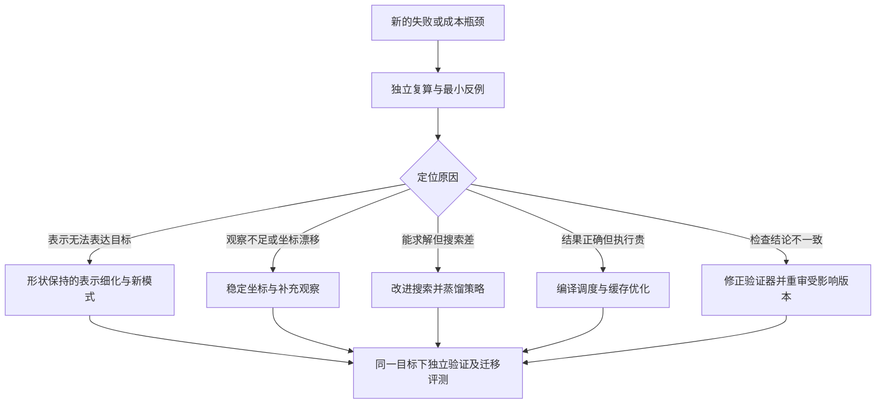

# 递归改进的深入修订：表示、搜索、技能与证据

日期：2026-11-20。设计修订 v2；结合 `SELF_IMPROVEMENT_PLAN.md` 阅读。
与 v1 冲突时以本修订和 `configs/improvement-plan.v2.json` 为准。v1 参数文件保留用于追溯。
本次只更新设计并运行 CPU 诊断；没有训练反馈模型、修改运行时或启动自动迭代。

核心修正：把递归产物扩展为可验证、可复用的建模技能，并先诊断瓶颈再分配训练/搜索/代码预算。
学习器、表示、原语、求解器、验证器和任务分布都可能限制效果，单纯增加模型版本不能解决所有瓶颈。

## 1. 当前数据揭示的三个边界

已运行的诊断可用 `python scripts/audit_improvement_assumptions.py` 复现，结果位于 `output/planning/`。

| 诊断 | 实际结果 | 对计划的影响 |
|---|---|---|
| 现有目标的最优值 | 二次最小二乘下界 2905.343433954875，与所选 GPU 分数在报告精度上一致 | 当前线性目标已饱和；继续训练无法带来该目标的质量提升 |
| 现有任务多样性 | 32 候选、1 个模板族、1 个用户目标 270 mm | 属于事务/回退验收，不是跨设计泛化证据 |
| 反馈坐标的语义 | 同一可行子空间换基后，原始 y 会变化；物理探针坐标可消除这种任意性 | 修改 v1 直接把 y 输入/输出模型的设计 |

当前有 29 个最终参数等于用户目标，另三个故意覆盖停止或预算路径。
`validation.json` 中每个 candidate 的 pass 表示该验收案例行为正确，不表示所有候选都完成了同一个造型任务。
新的任务报告必须分别记录执行正确、几何有效、任务达标和交付有效四个状态。

## 2. 先判断需要改进哪一层



对固定线性采样目标 T 和硬约束可行空间 `x=x_ref+Zy`，先计算：

```text
J_floor = min_y || W (T(x_ref + Zy) - target) ||²
```

若非线性附加惩罚非负，这仍可作为对应总目标的下界；浮点数值估计与经过误差界确认的证书分开报告。
如果必要的拟合下界已高于用户允许误差，应报告 OUT_OF_REPRESENTATION，而不是继续增加策略训练。
它表示当前表示/约束范围达不到要求，不表示所有 CAD 表示都无解。没有充分证据时仍是 UNKNOWN。

达到当前表示的上限后，可以通过精确升阶/插结点等方式把旧曲面嵌入更大的表示，再释放新的合法形变模式。
例如四片双三次可升级为更高次兼容曲面；固定边界与用户连续性要求保持，增加的是内部表达空间。
新表示必须证明或数值验证旧形状嵌入误差、导数、接缝及 STEP 等价性，再开启新能力版本。
表示扩展是递归路径之一，但不要求首个两小时实验同时完成它。

## 3. 修正 SVD 坐标：让动作具有稳定物理语义

`Z` 与 `ZQ`（Q 为正交矩阵）表示同一个可行子空间，而同一形状的坐标变为 `Qᵀy`。
当前确定性 harness 内的 Z 与 y 保持配套；跨模板训练的反馈网络则需要稳定的坐标语义。

对第一族固定四曲面，选择六个固定语义位置的高度探针 E，定义：

```text
q = E (x - x_ref)                     # 物理探针坐标，经模板尺度归一化后输入网络
delta_x = Z (EZ)^+ delta_q            # 网络提出物理增量，映射回可行空间
A_h delta_x ≈ 0                      # 继续以实际原始硬残差验收
```

要求 `rank(EZ)=6` 且条件数处于经标定的范围。满秩时，该映射对等价换基不变，且满足 `E delta_x=delta_q`。
缩放后的动作在实际控制点位移上限制信赖域，不能仅限制任意 latent 向量范数。
`x_ref` 是模板参考形状，不能使用隐藏的任务见证，否则会泄漏目标答案。

本次在当前模板测得 `cond(EZ)=4.030897179276171`。
64 次随机正交换基下，形变最大差异 2.8866e-14 mm；相同形状的原始 latent 坐标却可以相差显著。
探针的全局 UV 为：
`(0.25,0.5), (0.75,0.5), (0.5,0.5), (0.75,0.125), (0.25,0.875), (0.5,0.125)`。
这些位置由当前模板选取，随后应在整个兼容族内冻结；逐模板悄悄重选探针会再次改变网络输入语义。
变更 chart、UV 对应或坐标归一化必须产生新 ID 和兼容性映射。

这只解决可行子空间的换基任意性，不自动解决任意重参数化、拓扑重排、尺度或空间坐标系变化。
S0 增加换基、变量重排、单位变换、chart 对应和近秩退化检查；秩或条件数不确定时进入诊断路径。

v2 中 72 维方案保留为候选，但其中 6 维改为 q，6 维动作改为物理探针增量。
在固定 ABI 前，检查 trust radius、允许动作、目标定义等影响后续决策的状态是否被观察到。
找出“观察几乎相同而可接受动作相冲突”的状态对；先判断是信息丢失还是多个等价好动作，只有确有冲突才补充特征。
可与 96 维候选比较，额外提供目标梯度、曲率活跃约束梯度、近似 Hessian 对角和诊断状态。
额外求导也计入预算。9,612 参数不再是必须达到的架构指标；输入语义和可观测性先于网络尺寸冻结。

## 4. 让搜索和教师也获得改进

固定教师重标注能够改善策略在自身访问状态上的表现，但没有独立的教师能力增长机制。
为提高可达到的任务质量，采用以下有界闭环：

```text
当前策略 → 引导多步搜索/多初值优化 → 独立确认更好的可行解
        → 保留反事实分支和新技能 → 蒸馏为更便宜的策略 → 下一轮搜索
```

这借鉴 [Expert Iteration](https://arxiv.org/abs/1705.08439) 的搜索与学习相互促进思路；连续 CAD 任务需要自己的实现和证据。
教师组合可包括投影梯度/信赖域、较强确定性优化器、多初值和策略建议。其解是“当前最好已知”，不充当全局最优证明。
当前教师找不到解时保留未解任务；策略通过探索找到更好、经验证的解时，教师档案也随之更新。

同时检验模型的增量价值：比较确定性求解、神经初值加确定性修正、神经选择求解/步长、逐步神经形变。
在仅 6 DOF 的问题上，经典优化器可能已很便宜；先实测哪种分工更有效。
线性/可解析问题继续使用已知精确路径；小模型可以承担初值、模式选择、预条件或搜索预算分配。
校验器不依赖模型预测的价值或置信度。

## 5. 用可组合技能积累递归成果

每个有价值的搜索结果应考察能否抽取为带参数技能，例如：边界保持的截面拟合、局部曲率峰值消除、接缝匹配后联合平顺。
这些是候选技能，不表示相应 GPU 实现已存在。

一个技能包建议包含：

| 字段 | 作用 |
|---|---|
| 输入类型、坐标系、前置条件 | 确定适用范围与可用动作掩码 |
| 参数与几何作用区域 | 稳定语义及尺度 |
| 原语/子技能 DAG、后置条件 | 可执行组合及质量目标 |
| 读写集合、接缝/约束依赖闭包 | 决定哪些操作可并行、哪些量需要失效 |
| 事务检查点、回退方式 | 失败时保留有效结果 |
| 误差依据、独立反例、验证器版本 | 明确证据适用范围 |
| 资源模型与适用任务桶 | 可比较的实际成本 |

技能应在未参与抽取的同族任务上优于展开的原语序列，才进入技能库。
新技能晋级后可以蒸馏到模型，也可作为 CUDA 融合/批处理的编译单元；模型、技能库和执行器一起版本化。
参数编译成常量的单题特例归档为特例优化，不报告为通用建模技能。

模型改善、harness 改善和技能增长各自报告。多个有不同质量/成本优势的技能保留在档案中，
通过经过验收的路由选择；活动版本指针可以指向包含多个专家与回退路径的完整 bundle。

## 6. GPU harness 应成为可验证的搜索执行器

模型提出有类型的几何操作或技能 DAG。编译器根据读写依赖、缓存版本和约束影响范围，生成分桶的批量图。
独立候选、无冲突区域及有界试验分支并行；先以共享模板和批量采样获取实际收益，再决定是否引入更复杂调度。

“修改一个 patch”可能影响邻接 C2 接缝及全局目标。dirty region 必须扩展为约束/接缝依赖闭包，
局部缓存也必须依赖目标版本和模板版本；不能只按控制点索引判断两个操作相互独立。
GPU 并行执行顺序或融合方式改变时，需要核对轨迹、归约误差、内存边界和提交原子性。

保持每个内层批次无主机决策读回。完整轨迹可以在 episode/批次结束后读取；外层训练和代码编译正常使用 CPU。
CPU CAD 后端的布尔、裁剪、缝合和 STEP 仍按能力边界组织为外层/批次阶段。
最终比较对象包括达到同一质量的端到端可交付 STEP 成本；“更少 kernel”或“一次读回”只是解释指标。

## 7. 验证器也能学习，但规范与证据不能混淆

位级重放说明相同计算可重复；STEP 可打开说明交换/拓扑检查通过。二者都不能独立证明造型目标、连续域曲率或 Class-A 面质。
增加检查器分歧搜索：在有限几何域中寻找设备采样与独立密集/自适应求值结论不同的状态，缩小成可复现反例。
反例经过独立确认后加入回归和检查策略改进。这借鉴 [反例引导的合成循环](https://people.eecs.berkeley.edu/~sseshia/pubdir/asplos06-final.pdf)，不继承有限程序验证的完整性保证。

独立性不只看 CPU/GPU：若两端使用同一个错误的约束行生成器，仍可能重复同一个错误。
至少保留从原始设计约束重建的语义参考、另一套曲面/导数求值和 OCCT 交换检查；记录共享依赖。
发现不一致时先定位，不自动把任一实现当作绝对真值。

| 变化 | 处理方式 |
|---|---|
| 同一规范下旧检查器有 bug | 修复检查器；标记受影响证据/版本；用修复后的共同标准重评父版本和候选 |
| 新增用户质量要求 | 新契约，保留旧契约结果；单独报告新增能力与范围 |
| 数值结论暂不可靠 | UNKNOWN、加密求值或请求外部确认；不自动放宽标准 |

“规范固定”不等于把已知错误的检查实现永久固定。
如果一个旧版本的正确性证据被新反例推翻，记录 REVOKED_EVIDENCE 并重算其晋级依据；历史日志保留。
检查器升级必须同时控制误接受与误拒绝，避免通过拒绝所有复杂任务提高表面可靠性。

质量层次分别定义：几何/拓扑有效、用户截面与曲率目标、视觉面质，以及可选的空气动力学目标。
本项目当前几何平顺检查不能替代实际 CFD/风洞证据；“流线外形”和气动收益应使用不同验收来源。

## 8. 递归评测必须同时度量迁移、归因与成本

保留固定目标分布的 anchor 指标，另报新困难任务上的 frontier 覆盖。
课程生成器可以改变训练混合比例，但不能用新的容易分布替换旧基准后宣称能力提升。
额外建立与当前模板祖先分离的迁移任务，测量达到给定质量所需的新增标注、训练时间和求值次数。

兼容 ABI 下继续做 2×2 评测。对同一标量指标 Q（越高越好），明确交互项：

```text
model_gain   = Q(H0,M1) - Q(H0,M0)
harness_gain = Q(H1,M0) - Q(H0,M0)
interaction  = Q(H1,M1) - Q(H0,M1) - Q(H1,M0) + Q(H0,M0)
```

若收益完全来自 interaction，报告“组合协同收益”。可对兼容历史版本做跨代配对，检查是否过度绑定某一对实现。
不兼容 ABI 的组合明确标 N/A，不通过改变基线语义伪造独立贡献。
资格集打开前固定唯一提名组合及主指标；另外三个交叉单元用于归因，不能在看完资格分数后换一个组合晋级。
首轮可预登记总 alpha 预算 0.05，至多三次代际提名加一次最终审计、每次名义 0.01；
这需要有效的区间估计与独立评测前提，bootstrap 的实际行为仍需用先导实验校准。

v1 的 3 个百分点/5%/10%、99% bootstrap、32 模板和两小时是提案默认值，需由先导方差和最小实用收益校准后冻结。
统计区间的名义水平不能替代功效分析，少量模板尤其容易缺乏足够分辨率。
作为量级说明，若 64 个独立 Bernoulli 案例全部无错误，一侧 95% 置信上界仍约为 4.57%；
实际分层 STEP 案例存在相关性，不能直接套用该独立假设。
多代自适应试验也需要独立资格集、候选提名限制和明确的总检验预算；参考 [自适应数据分析的 holdout 问题](https://research.google/blog/the-reusable-holdout-preserving-validity-in-adaptive-data-analysis/)。
本项目没有实现 reusable holdout 算法，不声称已有相应保证。

小而真实的收益可以保留到 Pareto 档案中，后续组合为候选再验收；没有统计证据的版本保持未晋级。
记录错误率观测、覆盖范围、质量与成本向量，不把它们压成任意可调的单一自评分。

如果新版本主要节省运行成本，计算摊销：

```text
N_break_even = 生成/训练/搜索的 GPU 秒 / 每次任务节省的 GPU 秒
```

假设一代花 600 GPU 秒、每次只省 0.2 ms，需要约 300 万次任务才抵消这些 GPU 时间。
这是示例计算，不是当前实测收益。CPU、GPU、墙钟和磁盘成本分列，只有权重事先明确时才合成成本。
质量或新能力收益另行衡量；不能仅因单次内核快一点就推断递归总收益为正。

## 9. 修订后的第一批交付

先建立五个诊断，再冻结网络/反馈 ABI 并扩展 128 题非线性基线：

| 诊断 | 当前状态 | 下一步证据 |
|---|---|---|
| D0 坐标与秩 | 当前模板换基诊断已通过 | chart、尺度、变量重排及近退化模板测试 |
| D1 可达性与目标下界 | 当前二次目标已达到下界 | 新目标的可达性估计、见证及表示不足分类 |
| D2 可观测性与动作语义 | 待实现 | 混淆状态对、控制器隐状态、梯度特征的成本收益 |
| D3 模型增量价值与标定 | 待实现 | 强确定性基线、神经 warm start/路由/逐步策略的预算对照 |
| D4 验证器盲点 | 待实现 | 独立语义重建、检查器分歧搜索与最小反例集 |

随后沿 S2–S5 开展搜索蒸馏、技能提取和 harness 优化。
两小时上限只限制已经实现并通过前置验收的实验运行，不是开发时间估计，也不能为满足预算而跳过必要证据。
递归能力的明确证据包括：固定基准收益、新任务迁移、可复用技能增加、以及产生下一次可验证改进所需成本降低。
这些项目分别报告；完成若干自动循环仅证明流程能够运行。
